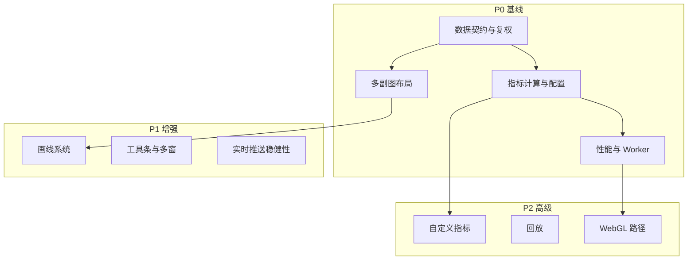

# 长期目标：功能规划与优先级

长期愿景：**在自研可控的前提下，能力上逐步对齐市面主流股票/期货 K 线产品**（如专业终端、互联网券商 App、TradingView 类体验）。  
下列功能按 **优先级 P0～P3** 排列；同优先级内可按业务再微调。**P0 为商业可用基线，P1 为差异化与效率，P2/P3 为高级与生态**。

---

## 1. 优先级说明

| 级别 | 含义 | 典型用户期望 |
|------|------|----------------|
| **P0** | 无则难以称为「行情产品」 | 日常看盘、下单前决策 |
| **P1** | 主流产品普遍具备 | 专业用户留存 |
| **P2** | 头部产品常见、实现成本高 | 深度分析与运营活动 |
| **P3** | 锦上添花或企业定制 | 品牌、协作、插件生态 |

---

## 2. P0 — 必须补齐（商业可用基线）

以下项建议在短期目标完成后，按顺序规划中长期迭代。

1. **完整行情数据契约**  
   - 复权（前复权/后复权/不复权）、除权除息、停牌、集合竞价展示策略。  
   - 多周期数据对齐、断点补全、与交易所时区/夏令时一致。

2. **稳定交互基线**  
   - 十字线 + 统一浮层：开高低收、涨跌幅、成交量、时间。  
   - 拖拽边界、惯性滚动（可选）、缩放中心点与**最小/最大 K 线宽度**限制。  
   - 加载更多历史（左侧/右侧）与 loading 态、空数据、错误态。

3. **副图体系**  
   - 多个可切换副图：成交量、成交额、MACD、KDJ、RSI 等中至少 **2～3 个** 作为首批。  
   - 副图高度可调、与主图**时间轴严格锁定**（缩放平移同步）。

4. **主图指标扩展**  
   - 均线族：MA/EMA/BOLL 等常见组合。  
   - 指标参数 UI（周期、线宽、颜色）与本地/云端配置持久化。

5. **性能与大数据**  
   - 万级 K 线级别下可交互（虚拟化、抽样或 WebGL 升级决策点）。  
   - 指标计算下放到 **Web Worker**（可与渲染主线程解耦）。

6. **工程与质量**  
   - 自动化测试（数据、指标、视口计算）。  
   - 内存与泄漏检测（长时间挂机、频繁切周期）。  
   - 可访问性基础：焦点、键盘操作、高对比（按监管/品牌要求）。

---

## 3. P1 — 主流竞品常规能力

1. **画线与标注**  
   - 趋势线、水平线、平行通道、斐波那契、文本标注。  
   - 线的选中、编辑、删除、磁吸 K 线高低点（可选）。

2. **多图表布局**  
   - 主图 + 多副图垂直栈；副图显示/隐藏、顺序拖拽。  
   - 分屏（同一屏幕多品种或多周期）——视产品形态选做。

3. **品种与周期切换**  
   - 顶部/底部工具条：周期、品种搜索、自选列表联动。  
   - 切换时状态保留（视口、指标配置）可配置。

4. **深度行情与关联展示（若业务需要）**  
   - 买卖盘、成交明细、Level2（与后端强相关，前端为展示与协议）。  
   - 分时图与 K 线联动（日内 ↔ 日 K）。

5. **主题与国际化**  
   - 深浅色主题、红涨绿跌/绿涨红跌地域习惯。  
   - 多语言、数字/日期格式化。

6. **实时与推送**  
   - WebSocket 重连、心跳、序列号防乱序。  
   - 最后一根 K 线合并与「新 K 线」动画策略。

---

## 4. P2 — 头部产品增强能力

1. **高级指标与公式**  
   - 自定义指标脚本（受限 DSL 或沙箱 JS）。  
   - 多指标组合模板、分享配置码。

2. **预警与条件**  
   - 价格穿越、指标金叉死叉等提醒（依赖推送与后台）。

3. **回放与训练**  
   - 历史 K 线回放、倍速、单步。  
   - 模拟交易叠加（若产品含教育/模拟盘）。

4. **截图与分享**  
   - 带水印/时间戳的图表导出 PNG；链接分享（需服务端配合）。

5. **协作与投教**  
   - 画线云同步、老师端标注广播（企业版常见）。

6. **渲染升级路径**  
   - 超大数据量时 **WebGL** 或 **WebGPU** 渲染路径；与现有 Canvas 分层方案并存或迁移策略。

---

## 5. P3 — 可选与生态

1. **插件/扩展 API**  
   - 第三方指标、自定义 overlay、事件钩子（onCrosshairChange 等）。

2. **桌面端与混合包**  
   - Electron / Tauri 封装；与原生行情内核通信。

3. **AI 辅助（视产品）**  
   - 形态识别、盘口摘要（合规审查后上线）。

---

## 6. 功能依赖关系（简图）

---

## 7. 与「完全对标主流」的差距说明

「完全对标」并非单一功能列表可闭合，还包含：

- **稳定性**：极端行情、弱网、长会话。  
- **合规**：展示规则、日志、适当性（视地区）。  
- **生态**：数据授权、资讯、F10 等外围系统。

建议将「完全对标」拆解为：**P0 全部完成 + P1 按目标用户群选 80% + P2 按投入选做**，并每季度对照竞品（如 2～3 个选定标杆）做差距评审。

---

## 8. 推荐推进节奏（与短期文档衔接）

1. 短期文档中的 **阶段 A～F 完成** → 具备分层、成交量、MA、移动端基础。  
2. 进入长期 **P0**：复权与数据契约、十字线信息层、第二个副图指标（如 MACD）、Worker 指标。  
3. 并行评估：若 K 线数量持续上升，在 P0 性能项中确定 **Canvas 优化 vs WebGL** 的门槛数据。  
4. **P1** 以画线与工具条为双主线，分期发布。

---

*文档版本：与《短期目标-实现路径》配套使用；优先级可根据实际业务（B 端内部工具 vs C 端零售）调整并保留变更记录。*
